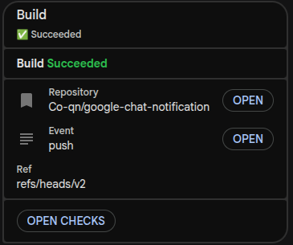
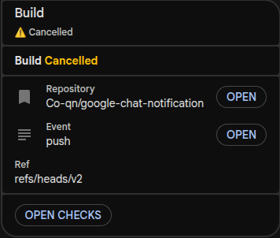
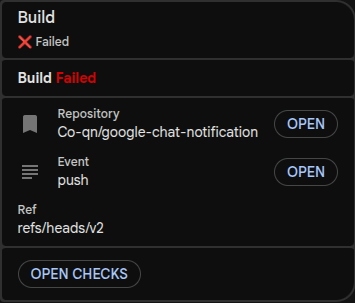

# Google Chat Notification for GitHub Actions


Sends a Google Chat notification using the [Cards v2](https://developers.google.com/workspace/chat/api/reference/rest/v1/cards) message format.

This repository is generated by [typescript-action](https://github.com/actions/typescript-action).

> **Note**: This action runs on `node24` and requires GitHub Actions runner v2.327.1 or later.





## Usage
### Parameters
|Name|Required|Description|
|:---:|:---:|:---|
|name|true|Job name. Used for notification titles.|
|url|true|Google Chat Webhook URL.|
|status|true|Job status. Available values are `success`, `failure`, `cancelled`. We recommend using `${{ job.status }}`|
|metadata|false|Custom metadata to include in the card. Multiline `key: value` format (one entry per line; the key must not contain `:`). Values starting with `http://` or `https://` get an OPEN button.|

### Examples
```yaml
- name: Google Chat Notification
  uses: Co-qn/google-chat-notification@releases/v2
  with:
    name: Build
    url: ${{ secrets.GOOGLE_CHAT_WEBHOOK }}
    status: ${{ job.status }}
  if: always()
```

With custom metadata:
```yaml
- name: Google Chat Notification
  uses: Co-qn/google-chat-notification@releases/v2
  with:
    name: Deploy
    url: ${{ secrets.GOOGLE_CHAT_WEBHOOK }}
    status: ${{ job.status }}
    metadata: |
      Deploy URL: https://myapp.example.com
      Environment: production
  if: always()
```
